# 💚 Cajita

> **Finanzas personales privadas y locales para iOS y Android.**  
> Tus datos financieros te pertenecen: viven cifrados en tu dispositivo y se respaldan en tu propia nube privada. Sin servidores de terceros, sin cuentas obligatorias, sin anuncios ni rastreadores.

---

## 📱 Capturas de Pantalla

### 🍏 iPhone (iOS)

| Inicio y Patrimonio | Cartera y Cuentas | Registro de Movimientos |
| :---: | :---: | :---: |
| 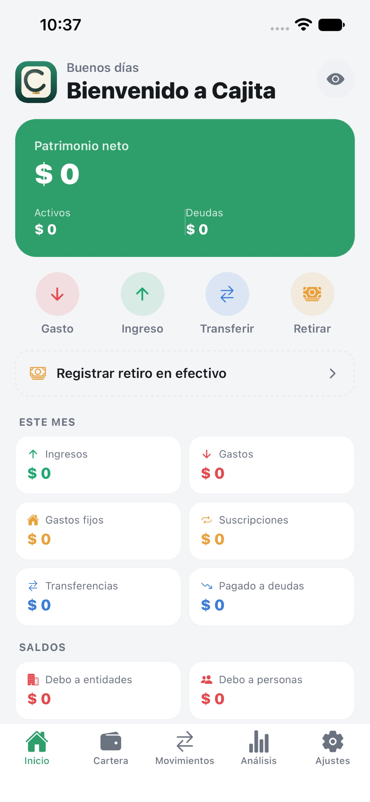 | 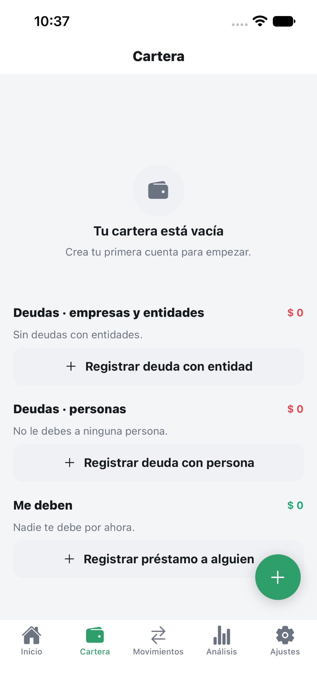 | 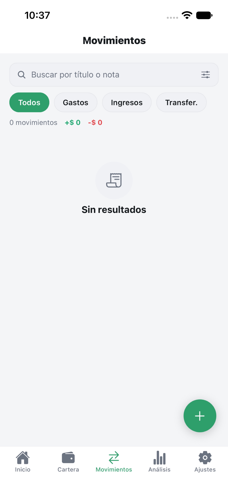 |

| Análisis y Gráficos | Atajos de iOS en Segundo Plano | Modo Oscuro |
| :---: | :---: | :---: |
| 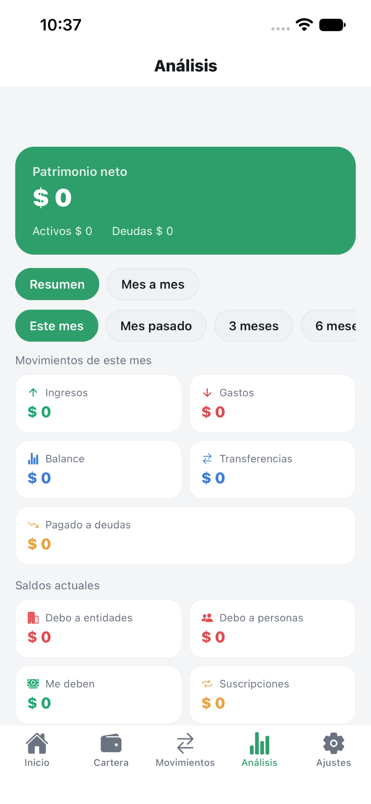 | 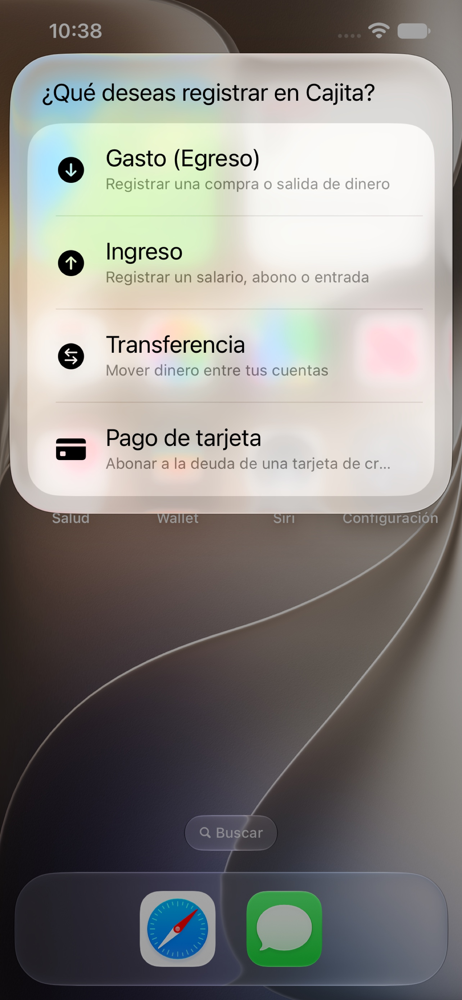 | 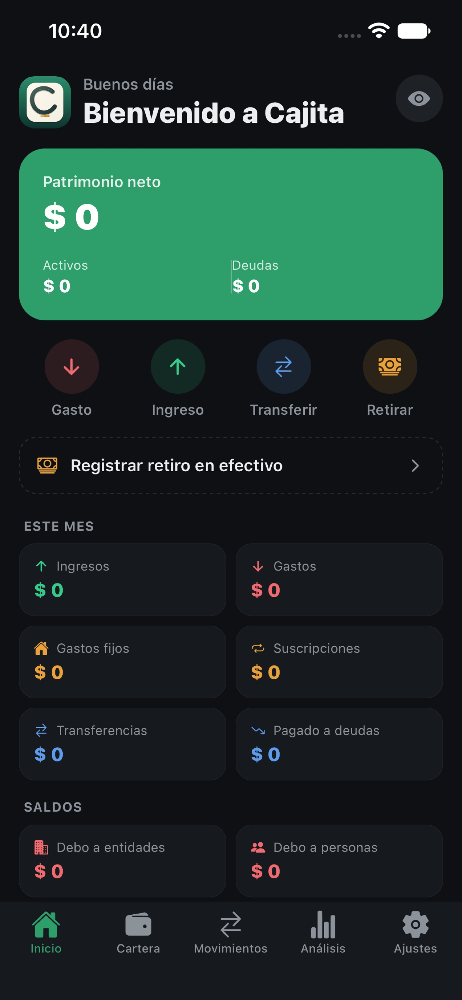 |

### 🤖 Android

| Inicio en Android | Cartera en Android | Movimientos en Android | Análisis en Android |
| :---: | :---: | :---: | :---: |
| 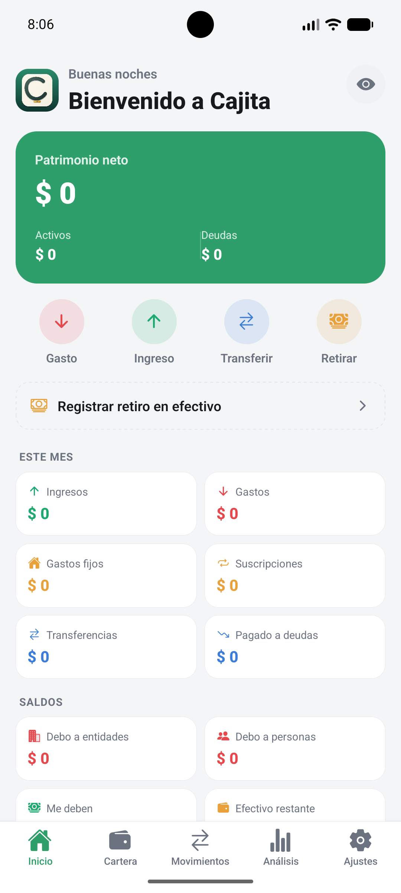 | 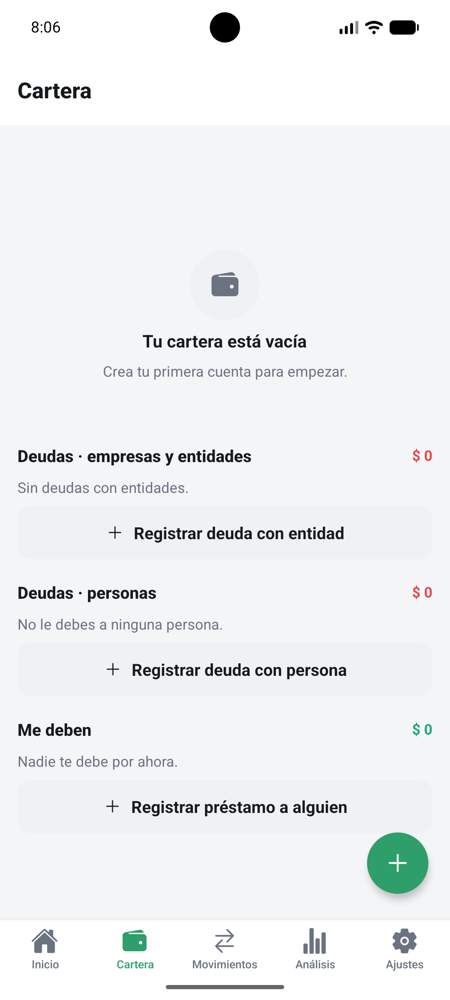 | 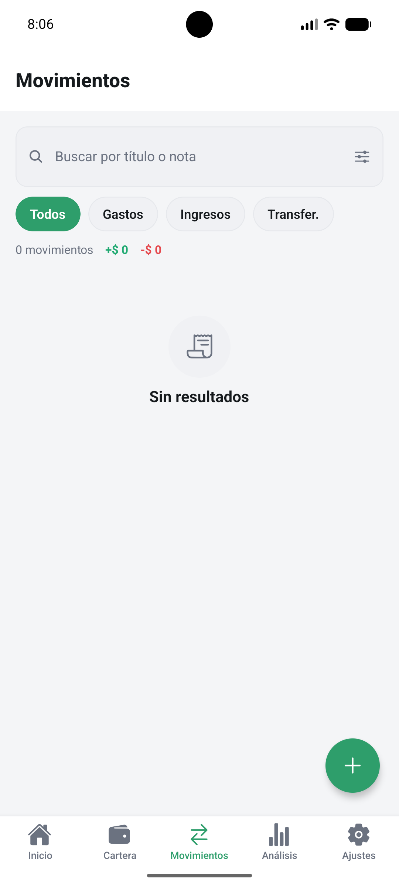 | 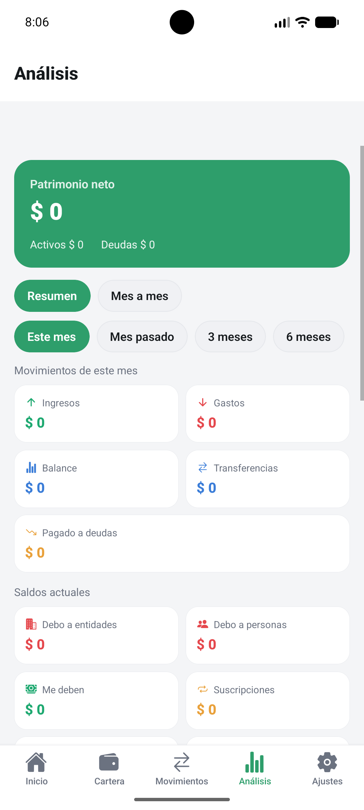 |

### 💻 iPadOS (Tablets)

| Inicio en iPad | Cartera en iPad | Movimientos en iPad |
| :---: | :---: | :---: |
| 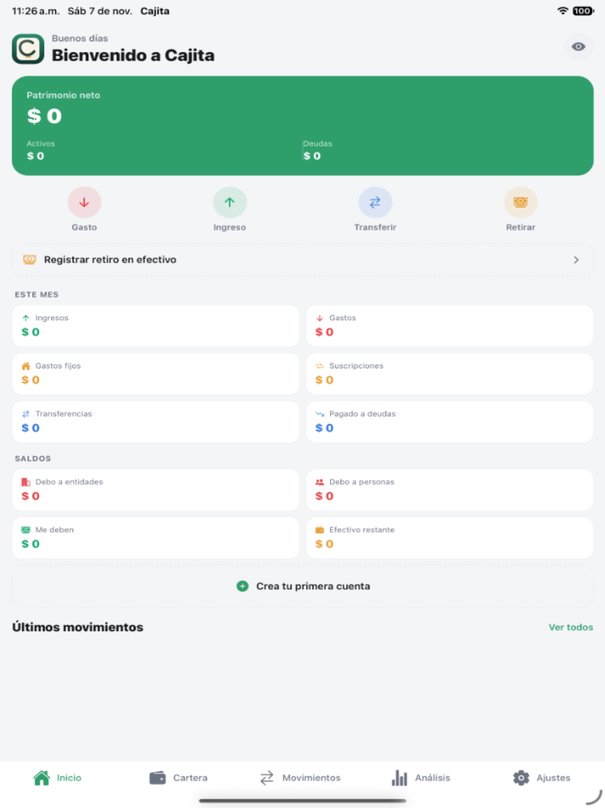 | 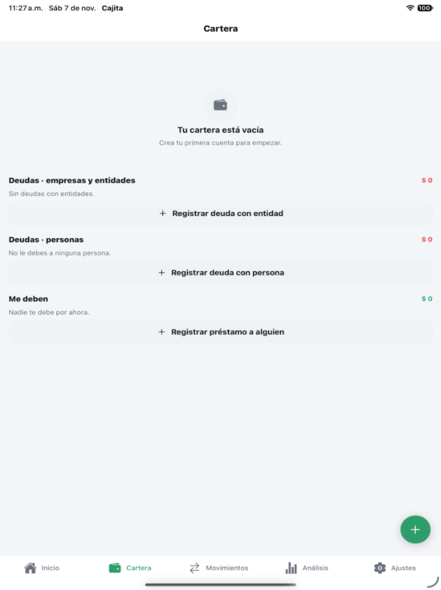 | 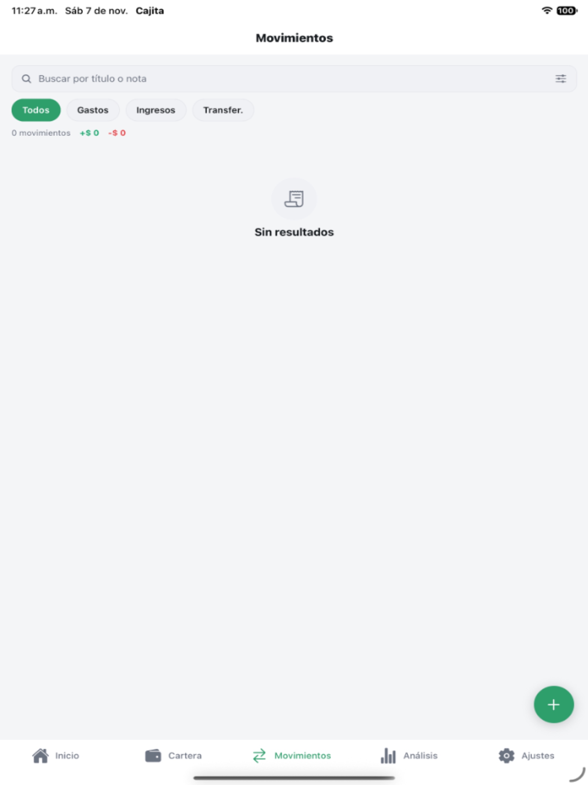 |

---

## 💡 ¿Por qué Cajita?

La mayoría de aplicaciones de finanzas personales exigen crear cuentas con correo, sincronizan tus ingresos y gastos en servidores ajenos o venden analíticas a intermediarios. 

**Cajita está diseñada bajo la filosofía *Local-First*:**
- **Privacidad Total**: Tu base de datos SQLite vive en tu teléfono y está cifrada de punto a punto con **SQLCipher (AES-256)**.
- **Sin Dependencias de Servidores**: Funciona 100% offline, en modo avión o sin cobertura móvil.
- **Sin Conexión Bancaria ni Acceso a Correos**: No vinculamos cuentas bancarias, no leemos correos electrónicos ni almacenamos credenciales. Todos los registros se ingresan conscientemente por ti dentro de la app o sus atajos.
- **Flujo Contable Real**: Las transferencias entre cuentas propias no distorsionan tus reportes de gastos o ingresos; los pagos a tarjetas de crédito reducen automáticamente la deuda de la tarjeta.
- **Cero Publicidad**: Sin SDKs publicitarios, sin venta de datos y sin suscripciones forzadas.

---

## ✨ Funcionalidades Principales

- **Gestión Integral de Cuentas**: Bancos, Efectivo, Ahorro, Tarjetas de Crédito (con control de cupo disponible), CDTs y Préstamos.
- **Registro Rápido con Selector de Calendario**: Registro ágil de gastos, ingresos y transferencias con fecha visual interactiva.
- **Acciones Rápidas y Atajos Nativos (iOS)**: Registra operaciones desde el **Botón de Acción**, **Toque Posterior (Back Tap)**, **Siri** o la app **Atajos** sin necesidad de abrir la aplicación.
- **Préstamos y Personas**: Control bidireccional de préstamos («Me deben» y «Debo») vinculado a contactos con historial de cuotas y saldos pendientes.
- **Gastos Fijos y Suscripciones**: Checklist mensual recurrente con alertas locales para recordar fechas de corte y vencimientos.
- **Retiros de Efectivo**: Registra el dinero retirado del cajero y controla cómo se gasta en efectivo durante el mes.
- **Métricas y Análisis**: Gráficos interactivos de evolución patrimonial, ingresos vs. gastos por categoría y presupuestos mensuales.
- **Seguridad Biométrica**: Bloqueo instantáneo con Face ID, Touch ID o huella dactilar.
- **Respaldo Privado en iCloud (iOS)**: Copia de seguridad automática y cifrada en tu cuenta privada de Apple ID.
- **Importación y Exportación**: Respalda en JSON y exporta tus transacciones en formato CSV libre cuando lo desees.

---

## 🛠️ Arquitectura y Tecnologías

Diseñado como un producto móvil robusto, moderno y ligero:

- **Frontend Móvil**: React Native + TypeScript con Expo (New Architecture / Fabric).
- **Almacenamiento Seguro**: Base de datos local SQLite cifrada por hardware con **SQLCipher (AES-256-CBC)**.
- **Integraciones Nativas**: Módulos nativos en Swift (`AppIntents`, sincronización iCloud con `NSFileCoordinator`) y compatibilidad multiplataforma para Android.
- **Diseño**: Interfaz moderna adaptable a modo claro y oscuro con múltiples temas de acento visual.

---

## 🚀 Inicio Rápido para Desarrolladores

Si deseas compilar o explorar el proyecto localmente:

```bash
# Clonar el repositorio
git clone https://github.com/TheOfYisu/Cajita.git
cd Cajita

# Instalar dependencias
npm install

# Iniciar entorno de desarrollo
npm start
```

> **Nota:** Debido a que la base de datos utiliza librerías nativas de cifrado (SQLCipher), se requiere compilar un build nativo para pruebas (`npx expo run:ios` o `npx expo run:android`).

---

## ☕ Apoya el Proyecto

**Cajita** es un proyecto independiente desarrollado con dedicación para ofrecer una herramienta financiera limpia, gratuita y verdaderamente privada.

Si la app te resulta útil en tu día a día y quieres apoyar su mantenimiento continuo y nuevas versiones, puedes invitarme un café:

<p align="left">
  <a href="https://ko-fi.com/theofyisus" target="_blank">
    
  </a>
</p>

👉 **[ko-fi.com/theofyisus](https://ko-fi.com/theofyisus)**

---

## 👤 Autor

**Jesús Daniel Garizao Mejía**  
Software Engineer & Creator  
- **GitHub**: [@TheOfYisu](https://github.com/TheOfYisu)  
- **LinkedIn**: [jesudgm](https://www.linkedin.com/in/jesudgm/)  

---

## 🤖 Créditos

Desarrollado con el apoyo de herramientas de IA:
- OpenCode · DeepSeek V4 Pro
- Claude Code · Sonnet 5
- Google Antigravity · Gemini

---

## 📄 Licencia

Copyright (c) 2026 Jesús Daniel Garizao Mejía (TheOfYisu). Todos los derechos reservados.  
Software propietario para uso personal.
